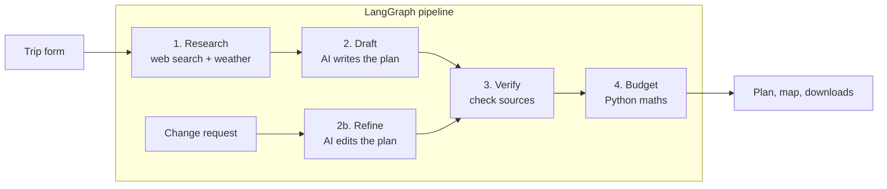

# 🌍 TripGenie — AI Travel Planner with Real Web Research

[](https://github.com/anant1123/Trip_Planner-Agent/actions/workflows/ci.yml)


TripGenie turns a few form fields into a complete, day-by-day trip plan with a budget, weather, a map and downloadable itineraries. It is built around one idea: **an AI travel planner should show where its numbers come from.**

Instead of letting a language model invent prices and "cite" searches it never ran, TripGenie runs the web searches itself, gives the model numbered results to work from, and then checks every price against those results before showing it to you.

---

## Table of contents

- [Features](#features)
- [How it works](#how-it-works)
- [Tech stack](#tech-stack)
- [Getting started](#getting-started)
- [Configuration](#configuration)
- [Using the app](#using-the-app)
- [Project structure](#project-structure)
- [Testing and code quality](#testing-and-code-quality)
- [Deployment](#deployment)
- [Security and privacy](#security-and-privacy)
- [Limitations](#limitations)
- [Troubleshooting](#troubleshooting)
- [Roadmap](#roadmap)
- [Contributing](#contributing)
- [License and data attribution](#license-and-data-attribution)

---

## Features

**Planning**
- Day-by-day itinerary with transport, hotel, activities, meals and tips, tailored to group type, food preferences, trip style, pace and special requirements.
- **Follow-up changes** in plain language: *"make day 2 cheaper"*, *"swap the museum for a market"*. The agent remembers the plan and edits it.
- Real-time progress while the plan is being made (research, writing, checking, budget).

**Trust and accuracy**
- Web searches are run by the application, not left to the model. Every search is logged.
- Each priced item is marked **✅ sourced** (backed by a search result) or **⚠️ estimate**. Real source links are attached by code, so the model can never invent a URL.
- The **budget is calculated in Python**: round-trip transport, rooms for the whole group, nights, and per-person totals. Warnings appear when the plan exceeds your budget.

**Extras**
- Weather for your travel dates (forecast, or last year's weather for later dates) from Open-Meteo.
- Prices shown in INR, USD, EUR or GBP using daily exchange rates.
- Map of each day's places.
- Export as **text (.md)**, **PDF** or a **calendar file (.ics)**.
- Trip history with JSON export and import.

**Engineering**
- Backup AI model if the main one fails, search fallback (Tavily → DuckDuckGo), result caching.
- Per-session usage limit to protect free API quotas on a public site.
- Unit tests, a Streamlit smoke test, GitHub Actions CI, Dockerfile and Dev Container.

---

## How it works

TripGenie uses a fixed pipeline built with [LangGraph](https://langchain-ai.github.io/langgraph/). Each step has one job, and the model is only responsible for the writing.



| Step | Done by | What happens |
|------|---------|--------------|
| **Research** | Python | Searches for transport, hotels, attractions, food and best time, in parallel. Results are numbered `[1]`, `[2]`, … Weather is fetched for the travel dates. |
| **Draft** | AI model | Writes a structured plan (validated with Pydantic) using only the numbered results. It cites results by *number*, never by URL. |
| **Refine** | AI model | For follow-up requests: edits the existing plan and keeps the same research. |
| **Verify** | Python | Drops source numbers that do not exist, attaches the real URLs, marks each price as sourced or estimate, and checks the number of days. |
| **Budget** | Python | Adds up costs for the whole group and compares them with your limits. |

LangGraph's in-memory checkpointer keeps the plan for each conversation, which is what makes follow-up changes possible.

---

## Tech stack

| Area | Technology |
|------|------------|
| Interface | [Streamlit](https://streamlit.io) |
| Agent pipeline | [LangGraph](https://langchain-ai.github.io/langgraph/), [LangChain](https://python.langchain.com) |
| AI model | [Groq](https://groq.com) — `llama-3.3-70b-versatile`, backup `llama-3.1-8b-instant` |
| Web search | [Tavily](https://tavily.com), with [DuckDuckGo](https://pypi.org/project/ddgs/) as a free backup |
| Places and map | [OpenStreetMap Nominatim](https://nominatim.org) |
| Weather | [Open-Meteo](https://open-meteo.com) |
| Exchange rates | [Frankfurter](https://frankfurter.dev) (European Central Bank rates) |
| Data models | [Pydantic](https://docs.pydantic.dev) |
| PDF export | [fpdf2](https://py-pdf.github.io/fpdf2/) |
| Quality | pytest, Ruff, GitHub Actions |

---

## Getting started

### Prerequisites

- Python 3.10 or newer
- A free [Groq API key](https://console.groq.com) (required)
- A free [Tavily API key](https://tavily.com) (optional — without it, DuckDuckGo is used for search)

### Installation

```bash
git clone https://github.com/anant1123/Trip_Planner-Agent.git
cd Trip_Planner-Agent

# Create and activate a virtual environment
python -m venv .venv
source .venv/bin/activate        # Windows (PowerShell): .venv\Scripts\Activate.ps1

pip install -r requirements.txt
```

### Add your API keys

```bash
cp .env.example .env             # Windows: copy .env.example .env
```

Open `.env` and fill in `GROQ_API_KEY` (and optionally `TAVILY_API_KEY`). The `.env` file is ignored by git and must never be committed.

### Run the web app

```bash
streamlit run app.py
```

Then open <http://localhost:8501>.

### Run from the command line

```bash
python main.py "Kota, Rajasthan, India" "New Delhi, India" --days 3 --people 2
```

---

## Configuration

Secrets and options come from the `.env` file, or from Streamlit secrets / environment variables when deployed.

| Variable | Required | Default | Description |
|----------|----------|---------|-------------|
| `GROQ_API_KEY` | Yes | — | Key for the AI model. |
| `TAVILY_API_KEY` | No | — | Better search results. Without it, only DuckDuckGo is used. |
| `STORAGE_MODE` | No | `local` | `local` saves history in `data/trip_history.json`. `session` keeps it only for the visit (use on public sites). |
| `MAX_RUNS_PER_SESSION` | No | `10` | Plans plus follow-up changes one visitor can request per session. |
| `LANGCHAIN_TRACING_V2` | No | off | Set to `true` (with `LANGCHAIN_API_KEY`) to enable LangSmith tracing. |

Everything else (model names, search limits, trip length, cache times) is in [`config/settings.py`](config/settings.py) and is documented in the file.

---

## Using the app

1. **Pick your places.** Type a starting point and a destination, then choose the exact match from the list. Nothing is pre-selected, so the wrong place is never used by accident.
2. **Set the trip details.** Start date, number of days (up to 14), travellers, group type, transport, hotel budget and an optional total budget per person.
3. **Add preferences.** Food, trip style, pace, where to stay and any special requirements.
4. **Click "Plan my trip".** A plan usually takes about 30 seconds.
5. **Read the plan.** Look at the ✅ / ⚠️ badges, the budget table and the Sources list.
6. **Ask for changes** in the box under the plan.
7. **Download** the plan as text, PDF or a calendar file. Past plans are in the **History** tab.

---

## Project structure

```text
.
├── app.py                  # Streamlit entry point (connects the pieces)
├── main.py                 # Command-line version
├── models.py               # Pydantic data models (request, plan, budget ...)
├── config/
│   ├── settings.py         # All settings and limits
│   └── prompts.py          # Instructions for the AI model
├── services/
│   ├── agent_service.py    # LangGraph pipeline (research → draft → verify → budget)
│   ├── research_service.py # Decides what to search and numbers the results
│   ├── search_service.py   # Tavily + DuckDuckGo search with caching
│   ├── verify_service.py   # Checks the plan against the real sources
│   ├── budget_service.py   # Budget maths
│   ├── weather_service.py  # Open-Meteo weather
│   ├── currency_service.py # Exchange rates
│   ├── location_service.py # Place search and geocoding (Nominatim)
│   ├── storage_service.py  # Trip history (file or in-memory)
│   └── export_service.py   # Markdown, PDF and calendar export
├── ui/
│   ├── form.py             # Planning form
│   ├── results.py          # Plan view, map, downloads
│   ├── history.py          # History tab
│   └── styles.py           # CSS and the tips page
├── utils/                  # Logging, input validation, formatting
├── tests/                  # Unit tests and a Streamlit smoke test
├── .github/workflows/      # CI (Ruff + pytest)
├── .devcontainer/          # GitHub Codespaces / VS Code Dev Container
├── Dockerfile
├── requirements.txt
└── requirements-dev.txt
```

---

## Testing and code quality

```bash
pip install -r requirements-dev.txt

ruff check .      # style and common mistakes
pytest -q         # all tests
```

The tests need no API keys or internet access. The AI model and the search service are replaced by small fakes, so the **whole pipeline** can be tested, including follow-up changes, model failure and fallback. They cover:

- input validation and prompt-safety cleaning
- budget maths (group rooms, round trips, warnings)
- source verification (made-up source numbers are removed)
- storage (damaged files, ID clashes, import/export, old-format trips)
- search fallback and caching, location lookup, weather, currency
- Markdown, PDF and calendar export
- a Streamlit smoke test that opens the real app

GitHub Actions runs Ruff and pytest on every push and pull request.

---

## Deployment

### Streamlit Community Cloud

1. Push the repository to GitHub.
2. Create an app on [share.streamlit.io](https://share.streamlit.io) with `app.py` as the main file.
3. In **Settings → Secrets**, add:

   ```toml
   GROQ_API_KEY = "your-groq-key"
   TAVILY_API_KEY = "your-tavily-key"
   STORAGE_MODE = "session"
   ```

`STORAGE_MODE = "session"` is important on a public site: each visitor then gets a private, temporary history instead of a shared file.

### Docker

```bash
docker build -t tripgenie .
docker run -p 8501:8501 --env-file .env tripgenie
```

The image sets `STORAGE_MODE=session` by default.

### GitHub Codespaces / Dev Container

Open the repository in a Codespace. Dependencies are installed automatically and the app starts on port 8501. Add your keys as Codespaces secrets or in a `.env` file.

---

## Security and privacy

- **API keys** are read from `.env` or the host's secrets. They are never stored in the code, and `.env` is git-ignored. If a key was ever committed, rotate it.
- **Prompt-injection hardening:** free text (notes and follow-up requests) is stripped of HTML, new lines and angle brackets and placed in a delimited block. Search results are treated as data, and the instructions tell the model to ignore commands found inside them.
- **No invented sources:** the model can only point to numbered search results. URLs are attached by code.
- **Input validation:** place names, dates, group size and trip length are checked before anything is sent to the model.
- **Quota protection:** per-session limit, search and location caching, and a rate limiter for Nominatim.
- **Private history:** in `session` mode no trip data is written to disk or shared between visitors.

**What leaves your machine:** trip details and search results go to Groq (the model); search queries go to Tavily or DuckDuckGo; place names go to OpenStreetMap Nominatim; coordinates go to Open-Meteo; a currency code goes to Frankfurter. Logs (`logs/`) and local history (`data/`) stay on your computer and are git-ignored.

---

## Limitations

TripGenie is a planning aid, not a booking engine. Please keep these in mind:

- **Prices are estimates.** ✅ *sourced* means the model cited a search result for the price. It does not prove that the exact number appears on that page. Always confirm prices before you book.
- **Search snippets are short**, so some prices cannot be found and are marked ⚠️ *estimate*.
- **Weather** beyond about two weeks ahead is last year's weather on the same dates, which is only a rough guide.
- **The map** looks places up by name. Generic or very local names may not be found.
- **Follow-up memory is in RAM.** After the server restarts, saved trips are still in History, but earlier plans cannot be changed with follow-up requests.
- **Free-tier limits.** Groq, Tavily and Nominatim have usage limits, so a busy public deployment may hit them.
- **All plans are made in INR.** Other currencies are display conversions only.
- **Trips are limited to 14 days** to keep the AI's answer reliable.

---

## Troubleshooting

| Problem | What to do |
|---------|------------|
| "Missing API key: GROQ_API_KEY" | Create `.env` from `.env.example` and restart the app. |
| `401 Invalid API Key` in the log | Create a new key in the Groq console and update `.env`. |
| `404 model_not_found` in the log | Model names can change. Pick a current model in the Groq console and update `model_name` in `config/settings.py`. |
| Tavily connection errors | Nothing to do. TripGenie falls back to DuckDuckGo automatically. |
| "Could not find these places on the map" | The plan used generic place names. Try again or ask for specific named places. |
| `ModuleNotFoundError` | Run commands from the project root and use `streamlit run app.py`. |
| History is empty after reopening a hosted app | Expected with `STORAGE_MODE=session`. Use **Download all trips** and **Import**. |

Logs are written to `logs/tripgenie.log` and include every web search that was run.

---

## Roadmap

- Screenshots and a live demo link
- Better map lookups using the destination's area to narrow the search
- Check that a cited price actually appears in the source text
- Persistent follow-up memory (SQLite checkpointer)
- Multi-city trips
- User accounts and cloud-saved history

---

## Contributing

Issues and pull requests are welcome.

1. Fork the repository and create a branch.
2. Install the dev tools: `pip install -r requirements-dev.txt`.
3. Make your change and add or update tests.
4. Run `ruff check .` and `pytest -q`. Both must pass.
5. Open a pull request describing what and why.

---

## License and data attribution

Released under the [MIT License](LICENSE).

TripGenie uses data from third parties:

- Place data © [OpenStreetMap](https://www.openstreetmap.org/copyright) contributors (ODbL), via Nominatim.
- Weather data by [Open-Meteo.com](https://open-meteo.com/) (CC BY 4.0).
- Exchange rates from the European Central Bank via [Frankfurter](https://frankfurter.dev).

Built by [@anant1123](https://github.com/anant1123).
